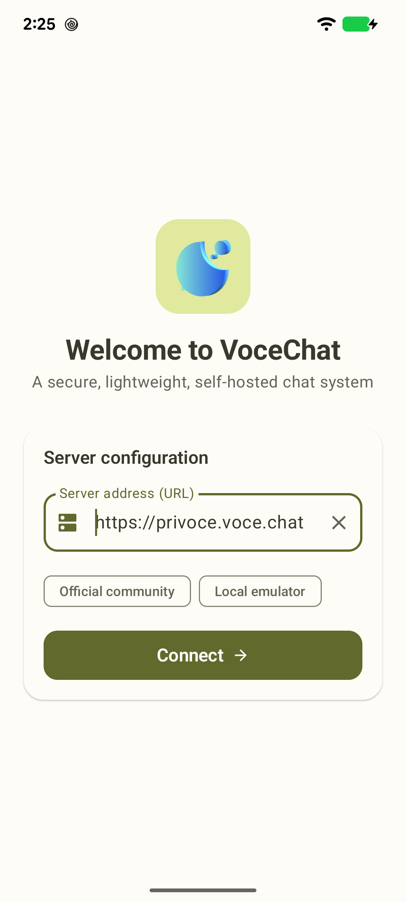
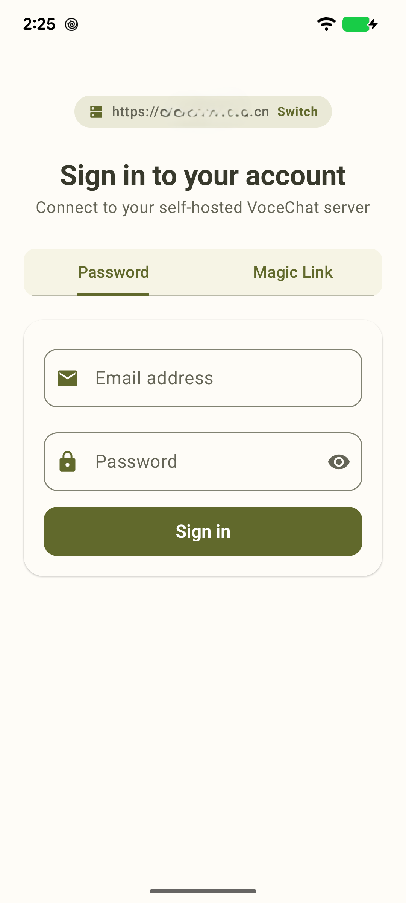
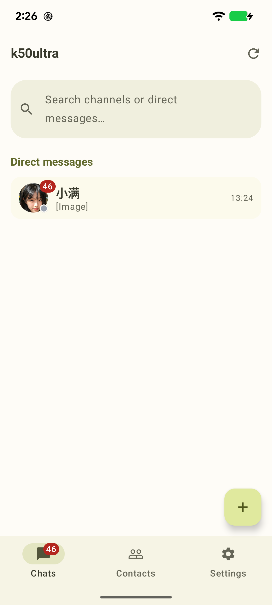
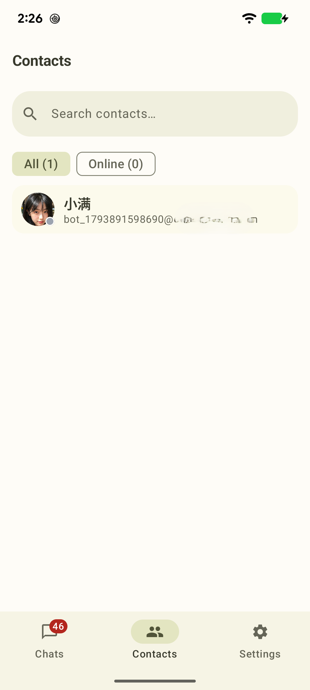
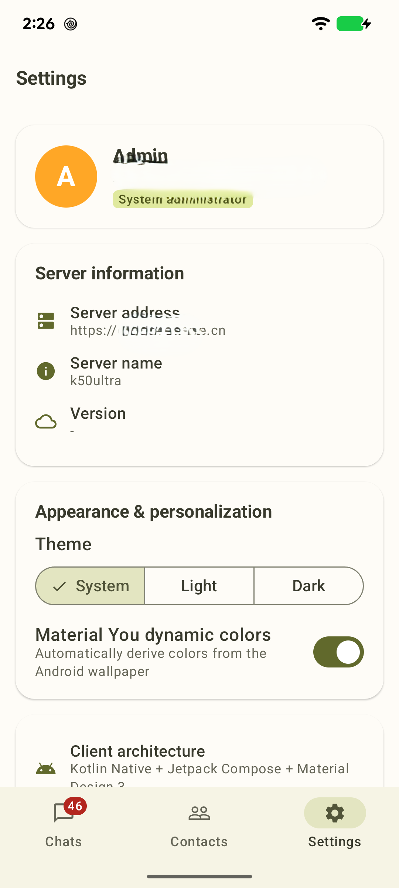
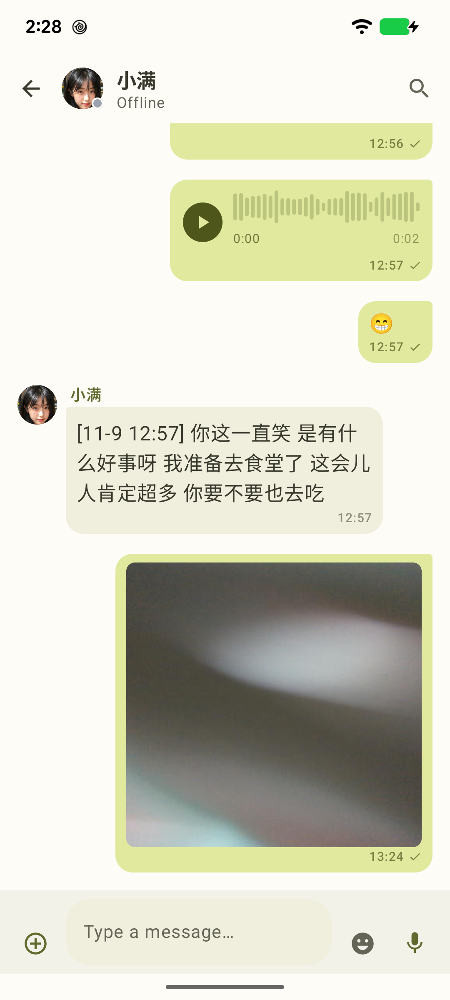
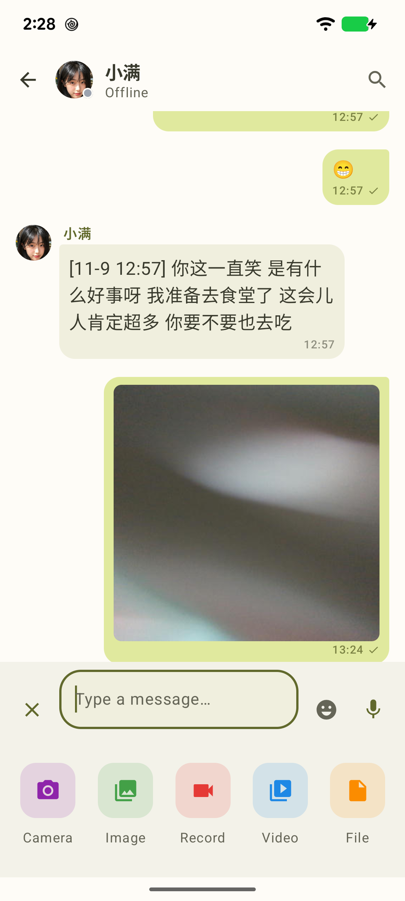

# VoceChat Android Client

[中文](#中文) · [English](#english)

---

## 中文

VoceChat Android 原生客户端，基于 **100% Kotlin + Jetpack Compose + Google Material Design 3 (Material You)** 打造。彻底移除了旧版 Flutter 及其跨平台冗余依赖，专注于为 Android 平台提供极速流畅、沉浸美观的即时通讯交互体验。

### 界面预览

| 服务器配置 | 账户登录 | 消息列表 |
| :---: | :---: | :---: |
|  |  |  |

| 通讯录 | 外观与个性化设置 | 聊天详情 | 多媒体附件操作 |
| :---: | :---: | :---: | :---: |
|  |  |  |  |

---

### 核心特性

- **纯血原生架构**
  - **100% Kotlin Native**（JVM 17 / 21），彻底剔除 Flutter，启动秒开，包体与内存占用大幅优化。
  - **Jetpack Compose + Material Design 3**：全面适配 Google Material You 规范。
  - **Jetpack Navigation Compose** 页面导航路由与转场动画。
  - **Kotlin 协程 + StateFlow** 响应式单向数据流架构。
- **Material You 现代交互体验**
  - **动态壁纸取色**：支持 Android 12+ Material You 动态色彩提取，UI 配色自适应系统壁纸。
  - **深浅主题切换**：支持跟随系统、浅色模式、深色模式自由切换。
  - **键盘友好交互**：输入框精准跟随软键盘平滑上浮（WindowSoftInputMode `adjustResize` 与 Window Insets 自适应），杜绝输入被遮挡。
  - **沉浸式多媒体全屏预览**：沉浸式隐藏状态栏与导航栏，支持高清大图左右手势水平滑动分页（Horizontal Pager）、缩放与双击查看。
- **全功能即时通讯**
  - **消息类型**：文本、Markdown 渲染、图片、音视频、文件附件与动态 Emoji 表情。
  - **消息交互**：气泡区分左右对齐（左侧他人，右侧自己）、引用回复（Quote Reply）、表情表态（Reactions）、复制、撤回/删除与发送失败一键重试。
  - **相机与录像安全适配**：安全支持拍摄照片与录制视频并一键发送，深度适配 Android 14+ / 17 安全 `FileProvider` 授权与 `rememberSaveable` 状态恢复，横竖屏切换无闪退。
  - **语音消息录制与播放**：长按即录、松开发送，实时动态音频波形振幅渲染与时长提示。
  - **通讯录与在线状态**：联系人全部 / 在线过滤筛选、自定义头像与默认头像渲染、在线/离线指示器、一键发起私信。
- **稳定高效的网络与数据层**
  - **REST API**：OkHttp 4 + Gson，统一网络模型映射。
  - **SSE 实时流**：OkHttp-SSE（Server-Sent Events）双工长连接，毫秒级推送聊天消息与成员在线状态。
  - **短效令牌自动续期**：内置 `TokenAuthenticator`，针对 VoceChat 服务端 5 分钟短效令牌提供无感续签与请求重试。
  - **高性能图片缓存**：Coil 2 双级内存与磁盘缓存，平滑加载网络头像与聊天多媒体缩略图。
- **多语言与国际化支持**
  - 内置 **7 种语言**：简体中文（zh）、English（en）、Deutsch（de）、Español（es）、Français（fr）、日本語（ja）、한국어（ko）。
  - 跟随系统语言自动适配，支持 Android 13+「应用语言（Per-App Language）」偏好单独设置。
  - 所有界面文案、状态标签、对话框与 Toast 提示均使用资源字符串本地化，零硬编码。

---

### 项目结构

```
android/
├── app/
│   ├── build.gradle
│   └── src/main/
│       ├── AndroidManifest.xml
│       ├── kotlin/com/privoce/vocechatclient/
│       │   ├── data/
│       │   │   ├── api/           # VoceApiClient、VoceSseClient、TokenAuthenticator
│       │   │   ├── models/        # 数据模型（Message、User、Channel 等）
│       │   │   ├── repository/    # VoceChatRepository 统一数据仓库
│       │   │   └── storage/       # 本地首选项及用户状态持久化
│       │   └── ui/
│       │       ├── components/    # VoceAvatar、AudioPlayer、VoiceRecorder 等通用组件
│       │       ├── screens/       # 登录、聊天、会话列表、通讯录、设置等 Compose 页面
│       │       └── theme/         # Material 3 ColorScheme、Type 与 Theme 定义
│       └── res/
│           ├── values/            # 默认语言（English）
│           ├── values-zh/         # 简体中文
│           ├── values-de/         # 德语
│           ├── values-es/         # 西班牙语
│           ├── values-fr/         # 法语
│           ├── values-ja/         # 日语
│           ├── values-ko/         # 韩语
│           ├── xml/file_paths.xml # FileProvider 共享目录
│           └── xml/locales_config.xml
└── build.gradle
```

---

### 编译与运行

1. 使用 **Android Studio Iguana / Jellyfish / Koala** 或更高版本打开项目根目录或 `android/` 目录。
2. 等待 Gradle 同步完成后，通过命令行或 Android Studio 运行：

```bash
cd android
./gradlew assembleDebug
```

生成的 APK 文件路径：

```
android/app/build/outputs/apk/debug/app-debug.apk
```

安装到连接的设备：

```bash
adb install -r android/app/build/outputs/apk/debug/app-debug.apk
```

---

## English

A native VoceChat Android client built with **100% Kotlin + Jetpack Compose + Google Material Design 3 (Material You)**. The Flutter framework has been completely removed to deliver an ultra-responsive, lightweight, and modern user experience tailored for Android.

### Screenshots

| Server Configuration | Sign In | Chats List |
| :---: | :---: | :---: |
|  |  |  |

| Contacts | Appearance & Settings | Chat Conversation | Media & Attachments |
| :---: | :---: | :---: | :---: |
|  |  |  |  |

---

### Features

- **Native Architecture**
  - **100% Kotlin Native** (JVM 17 / 21) with complete removal of Flutter dependencies.
  - **Jetpack Compose + Material Design 3** implementing Google's Material You design guidelines.
  - **Jetpack Navigation Compose** for smooth page transitions.
  - **Coroutines & StateFlow** for reactive unidirectional data flow.
- **Material You UI & Interactions**
  - **Dynamic Theming**: Android 12+ wallpaper color extraction with light and dark theme modes.
  - **IME-Aware Input**: Chat input bar smoothly adjusts when the soft keyboard appears (`adjustResize` with Window Insets).
  - **Immersive Fullscreen Media Preview**: Edge-to-edge fullscreen preview hiding system bars, supporting horizontal paging gestures, zooming, and double-tap zoom.
- **Comprehensive Messaging**
  - **Message Types**: Text, Markdown rendering, images, audio, video, documents, and emoji picker.
  - **Rich Message Actions**: Message alignment (others on the left, self on the right), quoted reply, emoji reactions, copy, delete, and one-tap retry for failed messages.
  - **Camera & Video Capture**: Take photos and record videos seamlessly with Android 14+ / 17 safe `FileProvider` grant handling and `rememberSaveable` state restoration.
  - **Voice Messages**: Hold-to-record voice notes with real-time waveform visualizer and AAC playback.
  - **Contacts & Presence**: Filter contacts by all/online, view user details, and initiate direct chats.
- **Networking & Reliability**
  - **REST API**: OkHttp 4 + Gson.
  - **Real-time SSE**: Server-Sent Events connection for instant message delivery and presence updates.
  - **Silent Token Renewal**: Custom `TokenAuthenticator` seamlessly refreshes VoceChat's 5-minute access tokens.
  - **Image Loading**: Coil 2 with multi-level memory and disk cache.
- **Internationalization**
  - Built-in translations for **7 languages**: English, Simplified Chinese, German, Spanish, French, Japanese, and Korean.
  - Automatically follows system locale or per-app language settings on Android 13+.

---

### Build & Run

```bash
cd android
./gradlew assembleDebug
```

Output APK:

```
android/app/build/outputs/apk/debug/app-debug.apk
```

Install to device via ADB:

```bash
adb install -r android/app/build/outputs/apk/debug/app-debug.apk
```
